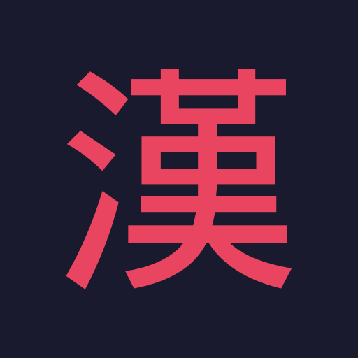

<div align="center">
  
  <h1>漢字る — Kanjiru</h1>
  <p>A Japanese kanji learning app built with React Native.</p>
  <p>
    
    
    
  </p>
</div>

---

## Features

- **Learn** — Browse kanji by JLPT level with meanings, readings, radicals, and stroke order diagrams
- **Animated stroke order** — Each stroke draws itself in sequence with order numbers, auto-playing when you open a kanji
- **Review** — Spaced repetition (SM-2) flashcard sessions with swipeable cards
- **Three question types** — Meaning, On-yomi, and Kun-yomi quizzes with multiple choice
- **Progress tracking** — See your SRS levels and learning history
- **Edge-to-edge dark UI** — Full-bleed dark theme with transparent system bars

## Tech Stack

| Layer | Library |
|---|---|
| Framework | React Native 0.76 (New Architecture) |
| Language | TypeScript |
| Navigation | React Navigation 7 (Stack + Bottom Tabs) |
| Animations | React Native Reanimated 3 + Gesture Handler |
| SVG | react-native-svg |
| State | Zustand |
| Local DB | op-sqlite + Drizzle ORM |
| Storage | react-native-mmkv |
| Server state | TanStack Query |
| Backend | Supabase |

## Getting Started

### Prerequisites

- Node.js 18+
- Android Studio with SDK & emulator (or a physical Android device)
- JDK 17

### Install

```bash
git clone <repo-url>
cd KanjiApp
npm install
```

### Run

```bash
# Start Metro bundler
npm start

# In a second terminal — build & install on Android
npm run android
```

### Regenerate stroke data

Stroke paths are sourced from [KanjiVG](https://github.com/KanjiVG/kanjivg) and cached locally (not committed). To rebuild `src/data/strokes.json`:

```bash
node scripts/buildStrokeData.js
```

SVGs are cached in `scripts/kanjivg/` after the first run, so subsequent runs are instant.

## Project Structure

```
src/
├── components/
│   ├── cards/          # SwipeableCard
│   └── kanji/          # StrokeOrderDiagram
├── data/               # kanji.json, strokes.json, mnemonics.json
├── engine/srs/         # SM-2 algorithm, distractor generation
├── hooks/              # useKanjiData, etc.
├── navigation/         # MainTabs, LearnStack, ReviewStack
├── queries/            # TanStack Query hooks
├── screens/
│   ├── learn/          # LevelPicker, LearnSession, KanjiDetail
│   ├── review/         # ReviewHome, ReviewSession
│   ├── progress/       # ProgressScreen
│   └── settings/       # SettingsScreen
├── stores/             # Zustand stores
└── types/              # TypeScript types

scripts/
├── buildKanjiData.js   # Builds kanji.json from source
├── buildMnemonics.js   # Generates mnemonics
├── buildStrokeData.js  # Downloads & extracts KanjiVG stroke paths
└── kanjivg/            # Local SVG cache (gitignored)
```

## Data Sources

- **Kanji data** — JMdict / KANJIDIC2
- **Stroke order** — [KanjiVG](https://github.com/KanjiVG/kanjivg) by Ulrich Apel (CC BY-SA 3.0)

## License

MIT
